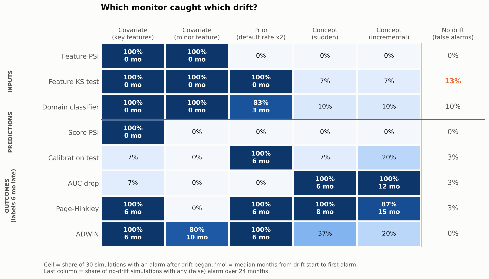
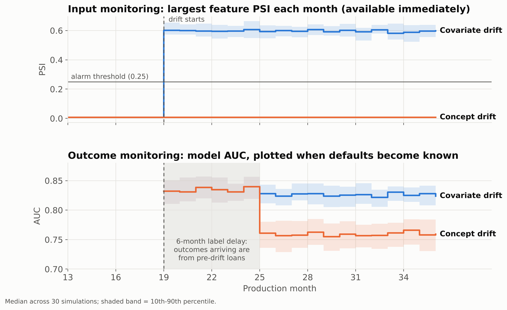
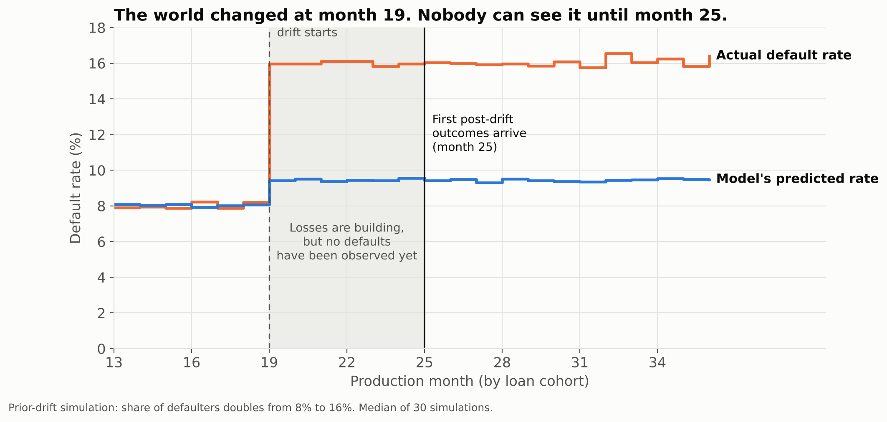
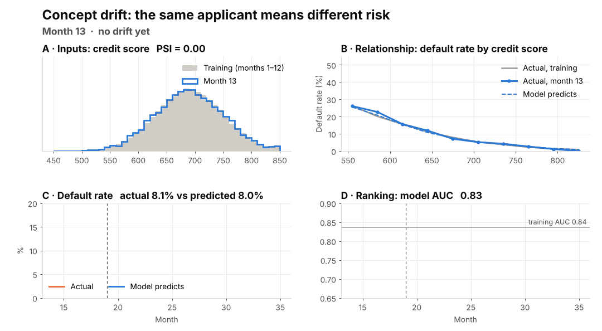

# Model Monitoring: Concept and Data Drift in Practice

Models quietly rot in production as the world changes underneath them. This repository
simulates a credit-default model month by month, injects each type of drift one at a time,
and measures **which monitoring signal catches which drift, and how quickly**.

**Main finding:** no single monitor catches every kind of drift. Input monitoring catches
covariate drift immediately but is blind to concept drift; outcome monitoring catches concept
and prior drift, but only after the label delay. Monitoring has to be layered.



## Drift types

A model learns from the joint distribution of inputs X and outcome y. Factor it two ways:

    P(X, y) = P(y | X) P(X) = P(X | y) P(y)

| Drift type | What changes | What stays the same | Simulated as |
| --- | --- | --- | --- |
| Covariate (data) drift | P(X), the inputs | P(y given X) | Incomes fall 30% and credit scores drop 30 points; or job tenure lengthens (a feature the model barely uses) |
| Prior drift | P(y), the default rate | P(X given y) | Share of defaulters doubles from 8% to 16%, resampling by class so each class looks the same |
| Concept drift | P(y given X), the relationship | P(X) | Income stops protecting, credit history barely matters, DTI matters more; overall default rate kept at 8% |

Concept drift is run twice: **sudden** (all at once at month 19) and **incremental**
(phased in linearly over 9 months).

## Experiment design

| Item | Setting |
| --- | --- |
| Data | Synthetic applicants: income, debt-to-income (DTI), credit score, years employed; 2,000 per month |
| True default model | Logistic in standardised features, parameters controlled per scenario |
| Monitored model | Logistic regression trained on months 1-12, then frozen |
| Production | Months 13-36, scored one month at a time |
| Drift onset | Month 19 |
| Label delay | 6 months: defaults for cohort c are only known in month c + 6 |
| Repetitions | 30 random seeds per scenario, plus a no-drift control |

### Monitoring layers

| Layer | Detector | Needs labels? | Alarm rule |
| --- | --- | --- | --- |
| Inputs | Feature PSI (Population Stability Index) | No | Largest feature PSI > 0.25 |
| Inputs | Feature KS test | No | Smallest p-value < 0.01 / 4 (Bonferroni) |
| Inputs | Domain classifier | No | Out-of-fold AUC > 0.5 + 3 standard errors |
| Predictions | Score PSI | No | PSI of model scores > 0.25 |
| Outcomes | Calibration test | Yes | Observed minus expected defaults beyond 3 standard errors |
| Outcomes | AUC drop | Yes | Monthly AUC below training AUC by more than 3 standard errors |
| Outcomes | Page-Hinkley | Yes | Cumulative rise in per-loan Brier score above threshold 40 (delta 0.002) |
| Outcomes | ADWIN | Yes | Variance-aware adaptive window split, delta 0.002 |

All detectors are implemented from scratch in [`detectors.py`](detectors.py) so every step can
be explained. PSI is

    PSI = sum over bins of (a_i - e_i) * ln(a_i / e_i)

with bins set at the deciles of the training data, e_i the training share and a_i the current
share in bin i. Industry rule of thumb: below 0.1 stable, 0.1-0.25 monitor, above 0.25 investigate.

## Results

30 simulations per scenario. "Caught" = share of simulations with an alarm after drift began;
delay = median months from drift start (month 19) to the first alarm.

| Drift | Caught immediately by | Caught later by | Missed by |
| --- | --- | --- | --- |
| Covariate (key features) | Feature PSI, KS, domain classifier, score PSI (100%, month 0) | Page-Hinkley, ADWIN (100%, 6 mo) although the model is still correct | Calibration, AUC (model still right) |
| Covariate (minor feature) | Feature PSI, KS, domain classifier (100%, month 0) | ADWIN (80%, 10 mo) | Score PSI (0%), calibration, AUC, Page-Hinkley |
| Prior (default rate 8% to 16%) | KS test (100%, month 0); domain classifier (83%, 3 mo) | Calibration, Page-Hinkley, ADWIN (100%, 6 mo) | Feature PSI, score PSI, AUC (rankings intact) |
| Concept (sudden) | Nothing | AUC drop (100%, 6 mo), Page-Hinkley (100%, 8.5 mo) | All input and prediction monitors; calibration (7%) |
| Concept (incremental) | Nothing | AUC drop (100%, 12 mo), Page-Hinkley (87%, 15 mo) | All input and prediction monitors; calibration (20%) |

False alarms in the no-drift control (any alarm over 24 months): KS test 13%, domain
classifier 10%, calibration, AUC and Page-Hinkley 3% each, PSI and ADWIN 0%. Small detection
rates such as the 7-10% for input tests under concept drift are at this noise level.

**What the results show**

1. **Concept drift is invisible to every label-free monitor.** The inputs and the model's
   scores do not change at all; only outcome monitoring sees it, and only after the 6-month
   label delay. Incremental concept drift takes twice as long to catch.
2. **Input alarms do not mean the model is broken.** Under covariate drift, inputs alarm in
   month 0 while AUC and calibration stay healthy, because the risk formula itself did not change.
3. **Score PSI filters out irrelevant input drift.** A large shift in job tenure, which the
   model barely uses, trips every input test but leaves the score distribution almost unchanged.
4. **Prior drift and concept drift break different outcome metrics.** A doubled default rate
   leaves rankings intact (AUC flat) but makes predictions too low (calibration fails); concept
   drift with a stable default rate does the opposite. Monitoring only AUC, or only calibration,
   misses one of them.
5. **Prior drift leaks into the inputs, weakly.** Because the applicant pool now contains more
   defaulter-like profiles, the KS test notices immediately even though PSI stays below 0.25.
6. **Sensitive tests cost false alarms.** The KS test catches the most but also raises the most
   false alarms with four features tested every month; PSI is coarser but quieter.





## Limitations

- **Simulated data is cleaner than reality.** One drift type at a time, a correctly specified
  model and no data-quality problems; real events usually mix all three drift types.
- **Thresholds are conventions.** PSI 0.25 and 3-sigma rules trade detection speed against
  false alarms; the sequential detectors were tuned so the no-drift control rarely alarms.
- **Error-based detectors react to the risk mix, not only to model failure.** Under covariate
  drift towards riskier applicants the per-loan error rises even though the model is still
  correct, so Page-Hinkley and ADWIN alarm anyway.
- **ADWIN is checked at monthly granularity** (one check per batch of 2,000 loans) rather than
  per observation, which keeps it fast and is enough for monthly monitoring.

## Visual drift demo

`demo_plots.py` animates what each drift does to the data and to the frozen model, month by month,
using the same data generator and model as the experiment (10,000 applicants a month, for smoother pictures).
Each frame has four panels: an input feature (with PSI), the default rate by credit-score band
(actual vs model), actual vs predicted default rate over time, and the model's AUC over time.



```bash
python demo_plots.py      # writes figures/demo/{data,label,concept}.gif and before/after PNGs
```

### Run the demo on Google Colab

1. Open [colab.research.google.com](https://colab.research.google.com) → **File → Open notebook → GitHub**, paste this
   repository's URL and choose `drift_demo.ipynb`. (Or **File → Upload notebook** and upload `drift_demo.ipynb`.)
2. In the first code cell, set `REPO_URL` to this repository. If you uploaded the notebook instead, upload
   `drift-monitoring.zip` in the Files panel and set `USE_ZIP = True`.
3. **Runtime → Run all.** Setup takes under a minute; each animation about 15–30 seconds.
4. Section 6 of the notebook has a scenario dropdown and a month slider for exploring live.

The notebook is generated by `make_notebook.py`; edit that file and rerun it to change the notebook.

## How to run

```bash
pip install -r requirements.txt
python run_experiment.py --seeds 30 --workers 4   # about 10-15 minutes on 2 cores
python make_figures.py
```

`results/metrics.csv` holds every signal for every seed, scenario and month;
`results/summary.csv` holds the detection rates and delays; `figures/` holds the charts.

## Repository layout

```
data_generator.py   synthetic loans and drift scenarios
model.py            baseline model: train and freeze
detectors.py        PSI, KS, domain classifier, calibration, AUC SE, Page-Hinkley, ADWIN
run_experiment.py   monthly monitoring loop over all scenarios and seeds
make_figures.py     charts used in the presentation
demo_plots.py       month-by-month drift animations (four-panel demo)
drift_demo.ipynb    Google Colab notebook for the live demo
make_notebook.py    writes drift_demo.ipynb
results/            experiment outputs
figures/            charts
```

## References

1. Moreno-Torres, J. G. et al. (2012). A unifying view on dataset shift in classification. *Pattern Recognition*, 45(1).
2. Gama, J. et al. (2014). A survey on concept drift adaptation. *ACM Computing Surveys*, 46(4).
3. Bifet, A. and Gavaldà, R. (2007). Learning from time-changing data with adaptive windowing. *SIAM SDM*.
4. Page, E. S. (1954). Continuous inspection schemes. *Biometrika*, 41(1/2).
5. Rabanser, S., Günnemann, S. and Lipton, Z. (2019). Failing loudly: an empirical study of methods for detecting dataset shift. *NeurIPS*.
6. Hanley, J. A. and McNeil, B. J. (1982). The meaning and use of the area under a ROC curve. *Radiology*, 143(1).
7. Board of Governors of the Federal Reserve System and OCC (2011). *SR 11-7: Supervisory Guidance on Model Risk Management.*
8. OSFI (2025). *Guideline E-23: Model Risk Management (2027)*, effective May 1, 2027.
